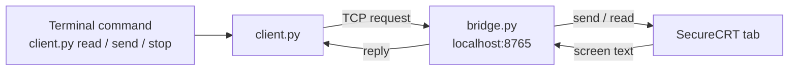

# Tiny SecureCRT bridge

This example uses simple Python to show how a bridge works. Each code line has a comment explaining it, including how sockets send and receive text.

It uses only Python's standard library. You need SecureCRT with Python 3 scripting support and Python 3 in your local terminal; no extra Python packages are needed.

1. Connect a SecureCRT tab and leave it at an idle command prompt.
2. In that tab, choose **Script > Run** and select `bridge.py` from this folder.
3. Leave the script running. In your local terminal, change into this folder from the repository root:

```sh
cd Toy_examples
```

Run these one at a time. These sample commands assume the connected tab is a Linux shell. After each `send`, wait for the output to appear in SecureCRT before running `read`:

```sh
python3 client.py read
python3 client.py send 'whoami'
python3 client.py read
python3 client.py send 'pwd'
python3 client.py read
python3 client.py stop
```

- `send` types the command and presses Enter. `OK` means the text was sent, not that the command finished or succeeded.
- `read` returns the visible terminal screen, including old text. It does not collect scrollback or wait for a prompt.
- `stop` ends the bridge and leaves the SecureCRT connection open. It does not stop a running remote command. Run `bridge.py` through **Script > Run** again to restart the bridge.

For a network device, use its commands instead, for example `python3 client.py send 'show version'`.

If the client reports `ConnectionRefusedError`, start this folder's `bridge.py` inside SecureCRT first. If SecureCRT shows an error when starting it, resolve that error before retrying the client.

This toy listens on localhost TCP port 8765 with no authentication or command restrictions. Other processes on this computer can send commands to the shared tab or read its screen while the bridge runs. The main MCP bridge's private Unix-socket permissions and command profiles do not apply to this example. Use a lab session and stop the bridge when finished.



The path is: **client.py → localhost port 8765 → bridge.py → SecureCRT tab**. Start only one copy at a time. All SecureCRT API calls stay on the script thread. This is a standalone learning example, not an MCP server.
