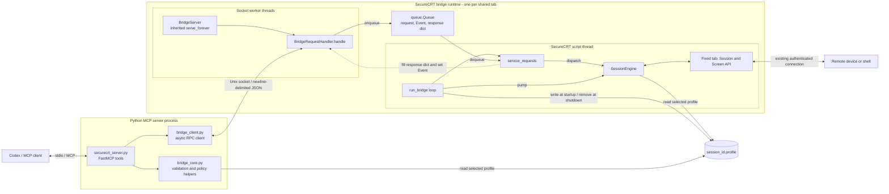
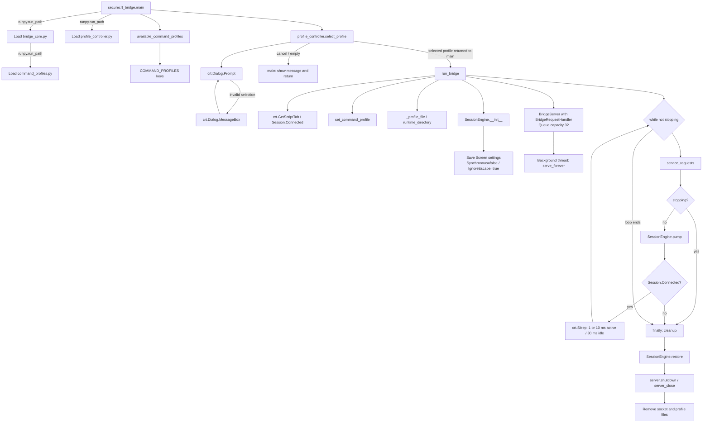
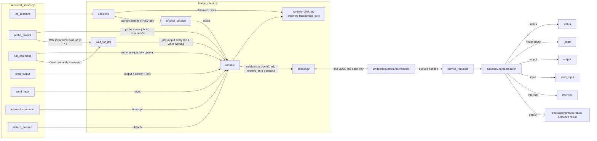
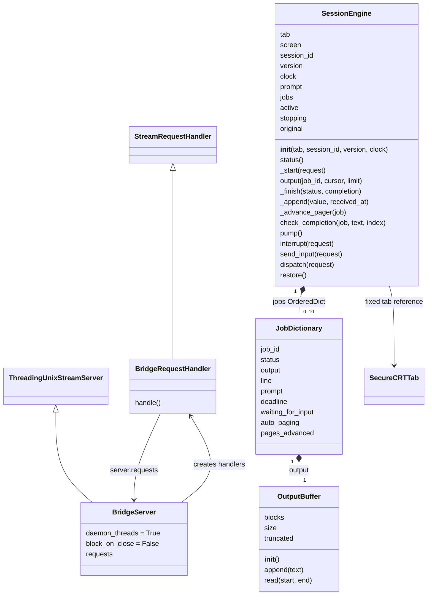
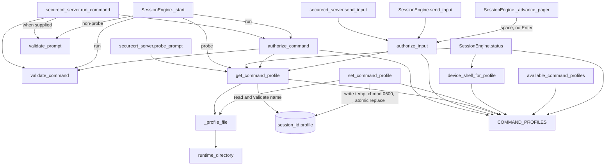
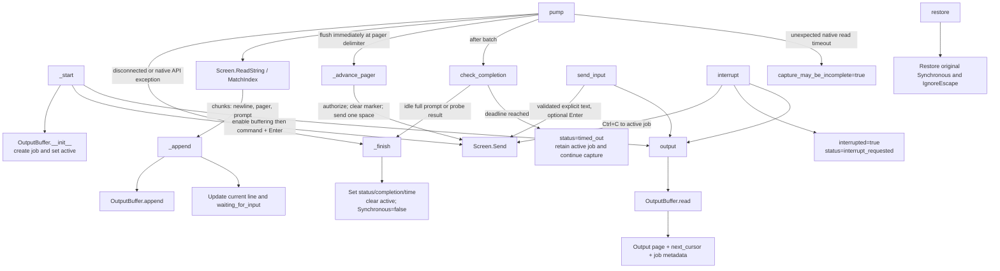
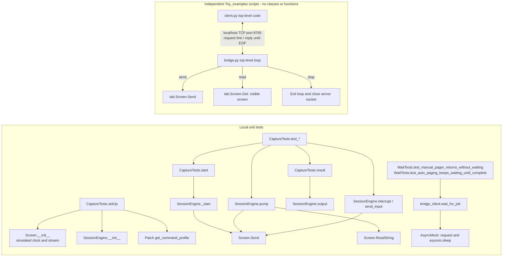

# SecureCRT MCP communication diagrams

These diagrams describe the current Python implementation. They cover every production function and class; tests and the standalone toy example are shown separately. Arrows in flowcharts indicate calls or explicitly labeled data transfers. Names without a module prefix inside the engine diagrams are `SessionEngine` methods.

## 1. Processes, threads, and transports



The socket is `/tmp/securecrt-mcp-<uid>/<session_id>.sock`. Each RPC uses a new connection and exchanges one request and one response. Socket threads never call SecureCRT APIs. `bridge_core.py` is loaded in both runtimes, but the MCP process only uses its helpers; the engine and listener run inside SecureCRT.

## 2. Startup, profile selection, and shutdown



An unconnected tab returns before bridge creation. The `finally` cleanup also runs on exceptions within the listener/loop block. Detaching sets `stopping`; it does not close the remote connection or send Ctrl+C.

## 3. Every MCP tool and RPC route



`wait_for_job` returns when status is no longer `running`, a manual pager is waiting, or its wait deadline is reached. `inspect_session` converts unavailable bridges into listing errors so other sessions can still be returned. `request` raises on an RPC error and never automatically retries a write.

## 4. Classes and ownership



`JobDictionary` is a diagram representation of a Python dictionary, not a declared class. The other two unimplemented base classes belong to `socketserver`. `BridgeServer` defines settings only; its networking methods are inherited. An engine owns at most one active job. Each buffer retains up to 1,000,000 characters in 4,096-character blocks.

## 5. Validation and policy function calls



Validation happens in the MCP tool and again at the bridge boundary. `_start` also checks job identity, tab ownership, connection, timeout, and `auto_paging`; an already known job ID returns its existing output. `SessionEngine.send_input` checks active ownership and printable input. `runtime_directory` creates/checks the user-owned 0700 runtime directory. Full profiles allow printable commands; restricted profiles check whole-word prefixes and simple argument characters.

## 6. Engine calls and terminal output capture



`pump` calls `_append` with collected chunks and `_advance_pager` at pager boundaries; the read node shows the data source. Reads are batched for roughly 50 ms, but an individual native read can block for one second. Completion requires stream inactivity for at least one second. Interrupt requests keep ownership until completion is detected. A failed initial `Send` leaves the job active with `send_failed_delivery_unknown` because delivery may have partially succeeded.

## 7. One command from request to result

```mermaid
sequenceDiagram
    participant A as Codex
    participant T as securecrt_server.run_command
    participant C as bridge_client
    participant H as BridgeRequestHandler.handle
    participant Q as Queue / Event / response dict
    participant L as run_bridge / service_requests
    participant E as SessionEngine
    participant S as SecureCRT Screen
    A->>T: command, session_id, options
    T->>T: validate and authorize; generate job_id
    T->>C: request(operation=run)
    C->>H: exchange: JSON over Unix socket
    H->>Q: enqueue(request, event, response)
    H->>H: wait on event (up to 6 s)
    L->>Q: dequeue (up to 32 requests per pass)
    L->>L: reject expired request before dispatch
    L->>E: dispatch → _start
    E->>E: validate; create job and buffer
    E->>S: Synchronous=true; Send(command + Enter)
    E-->>L: output snapshot
    L->>Q: write result or error; event.set()
    Q-->>H: wake worker with shared response
    H-->>C: JSON response
    C-->>T: result
    loop script loop while job remains active
        L->>E: pump()
        E->>S: ReadString(delimiters, 1)
        S-->>E: text + MatchIndex
        E->>E: _append → OutputBuffer.append
        opt standalone pager and automatic paging enabled
            E->>S: _advance_pager → Send(space)
        end
        E->>E: check_completion; possibly _finish
    end
    opt wait_seconds is nonzero
        T->>C: wait_for_job(session_id, job_id, wait_seconds)
        loop poll until status changes, pager waits, or wait expires
            C->>H: request(operation=output), same queue route
            H->>Q: enqueue output request
            L->>Q: dequeue
            L->>E: dispatch → output → OutputBuffer.read
            E-->>L: text page and job metadata
            L->>Q: write response; event.set()
            Q-->>H: wake worker
            H-->>C: JSON response
        end
        C-->>T: latest output snapshot
    end
    T-->>A: output, job_id, next_cursor, status
```

Capture and client polling interleave; the sequence separates them visually for readability. Output is retrieved by polling, not pushed to the MCP client. `read_output` follows the same output route and can supply `next_cursor` to fetch later pages. Job timeout, client wait expiry, and RPC timeout do not stop the remote command.

## 8. Tests and standalone toy example



The capture tests cover paging, prompt discovery, incomplete capture, interruption, send failure, cursor reads, truncation, and invalid options. They use a simulated `Screen`, not SecureCRT. The toy example is separate from MCP: it has no job engine, profile checks, or Unix-socket queue architecture.

## Source files

- [securecrt_server.py](securecrt_server.py): MCP tools and stdio entry point.
- [bridge_client.py](bridge_client.py): discovery, JSON RPC, and polling.
- [securecrt_bridge.py](securecrt_bridge.py): SecureCRT entry point.
- [bridge_core.py](bridge_core.py): policy helpers, socket server, engine, and buffers.
- [profile_controller.py](profile_controller.py): profile selection dialog.
- [command_profiles.py](command_profiles.py): shell declarations and command permissions.
- [test_bridge_core.py](test_bridge_core.py) and [test_bridge_client.py](test_bridge_client.py): simulated tests.
- [Toy_examples](Toy_examples/README.md): independent beginner example.
